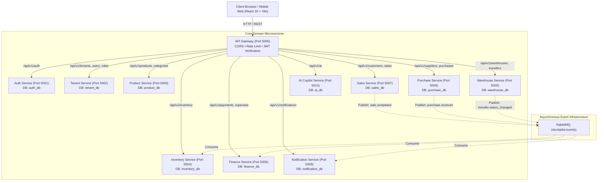
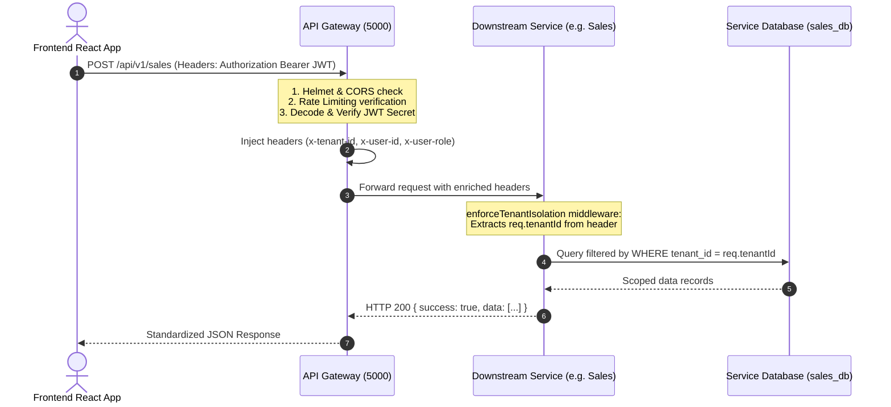

# StockPilot — System Architecture & Topology

## 1. High-Level Architecture Overview

StockPilot follows a **Cloud-Native Microservices Architecture** designed around bounded contexts. Each domain service owns its independent business logic and isolated MySQL database, coordinating with other services via synchronous HTTP proxies through the API Gateway and asynchronous message events over RabbitMQ.

---

## 2. Request Lifecycle & Gateway Processing

When a request arrives at the API Gateway:

---

## 3. Microservice Domains & Port Registry

| # | Service Name | Host Port | Database | Primary Domain Logic |
| :---: | :--- | :---: | :--- | :--- |
| **0** | **API Gateway** | `5000` | *None* | Central reverse proxy, JWT translation, request rate limiter, security headers. |
| **1** | **Auth Service** | `5001` | `auth_db` | User credentials, password hashing (bcrypt), token issuance, refresh token rotation. |
| **2** | **Tenant Service** | `5002` | `tenant_db` | Tenant organization onboarding, role definition matrix, user membership, platform admin audit. |
| **3** | **Product Service** | `5003` | `product_db` | Product catalog, SKUs, barcode tracking, categories, brands, variants. |
| **4** | **Inventory Service** | `5004` | `inventory_db` | Stock calculation (`Current - Reserved`), warehouse allocation, 8-movement audit ledger. |
| **5** | **Warehouse Service** | `5005` | `warehouse_db` | Multi-warehouse management, bin locations, inter-warehouse transfer workflow (`PENDING` -> `APPROVED` -> `COMPLETED`). |
| **6** | **Purchase Service** | `5006` | `purchase_db` | Supplier catalog, Purchase Order (PO) approval flow, tax/discount calculation, purchase returns. |
| **7** | **Sales Service** | `5007` | `sales_db` | Point of Sale (POS) invoicing, customer balances, instant stock checks, printable tax invoices. |
| **8** | **Finance Service** | `5008` | `finance_db` | Payment receipts, multi-category operational expenses, net profit/loss calculations. |
| **9** | **Notification Service** | `5009` | `notification_db` | System notifications, low stock warnings, transfer alerts. |
| **10**| **AI Service** | `5010` | `ai_db` | Intelligent assistant, prompt fallbacks, inventory forecasting insights. |

---

## 4. Inter-Service Communication Patterns

### 1. Synchronous HTTP (Query / Direct Validation)
Used when a service needs an immediate response to complete its operation:
- **API Gateway -> Microservices**: Reverse proxy via `http-proxy-middleware`.
- **Sales Service -> Inventory Service**: Synchronous check to verify that `Available Stock >= Quantity` before invoice checkout.

### 2. Asynchronous Event-Driven (RabbitMQ Pub/Sub)
Used for eventual consistency, background jobs, and decoupled cross-service triggers:
- **Exchange Name**: `stockpilot.events` (Topic exchange).
- **Format**: JSON payloads containing `{ event, tenantId, timestamp, data }`.
- See [EVENT_DRIVEN_FLOWS.md](file:///e:/STOCK_PILOT-IMS/docs/EVENT_DRIVEN_FLOWS.md) for complete event catalog.

---

## 5. Technology Stack Summary
- **Backend Framework**: Node.js, Express.js.
- **ORM / Database Engine**: Sequelize ORM, MySQL 8.0.
- **Message Broker**: RabbitMQ 3 (AMQP 0-9-1).
- **In-Memory Cache**: Redis 7 Alpine.
- **Frontend Framework**: React 18, Vite, Redux Toolkit, Lucide Icons.
- **Containerization**: Docker, Docker Compose.

---

## 6. Multi-Tenant Storefront Builder & Public Domain Architecture

### 1. Dynamic Modular Storefront Engine
Tenants configure custom e-commerce storefronts using a Shopify/Wix-inspired visual workbench:
- **Storage**: `tenants.store_config` stored as `LONGTEXT` in `tenant_db` (preventing silent 64KB truncation).
- **Navigation Controls**: Configurable header features (`showSearch`, `showCustomerAuth`, `showCart`, `showWhatsApp`, `showPhone`, custom menu links).
- **Hero Patterns**:
  - `SPLIT`: High-conversion 2-column layout (headline & CTA on left, glass showcase with verified badge on right).
  - `CAROUSEL`: Multi-slide promotional carousel with slide-by-slide titles, images, links, controls, and pagination.
  - `CINEMATIC`: Fullscreen brand hero with dark gradient overlay and bold typography.
- **12 Enterprise Modular Blocks**: Flash sale countdowns, product carousels, category tiles, product grids, lookbooks, brand narratives, reviews, FAQ accordions, and contact locators.

### 2. Multi-Tenant URL & Domain Routing Strategy
StockPilot supports three tiers of storefront domain resolution:
1. **Path-Based (Current / Default)**: `app.stockpilot.store/store/:companyCode`
   - Zero-configuration required; client extracts `:companyCode` from route params.
2. **Subdomain-Based (Enterprise Multi-Tenant)**: `zara.stockpilot.store`
   - Nginx / Cloudflare wildcard DNS (`*.stockpilot.store`).
   - Gateway / Frontend extracts tenant subdomain (`req.headers.host.split('.')[0]`), resolving tenant automatically without exposing URL paths.
3. **Custom Domain CNAME**: `shop.zarafashion.com`
   - Tenant creates CNAME record pointing to `cname.stockpilot.store`.
   - SSL certificates auto-provisioned via Let's Encrypt / Cloudflare for SaaS.
   - Database mapping: `tenants.custom_domain` -> `company_code`.

### 3. Customer Authentication & Live Order Tracking
- **Tenant-Scoped Customer Accounts**: Customers register and log in to a specific tenant's storefront (`/api/v1/sales/public/customer/*`), preventing cross-store data leakage.
- **6-Stage Visual Stepper**:
  `PLACED` -> `CONFIRMED` -> `PACKED` -> `SHIPPED` -> `OUT_FOR_DELIVERY` -> `DELIVERED`.
- Real-time courier tracking (AWB, carrier name) and instant WhatsApp support integration.

### 4. Multi-Warehouse Storefront Order Routing & Stock Fulfillment
- **Catalog Aggregation**: The public store catalog displays `availableStock` calculated as the sum of available stocks across all active tenant warehouses (`SUM(current_stock) - SUM(reserved_stock)`).
- **Fulfillment Warehouse Resolution**:
  When a public storefront order is received (`POST /api/v1/sales/public/order`):
  1. **Stock-Priority Lookup**: The system queries `inventory_db.stocks` to find the warehouse with the highest available inventory for the ordered items (`available_stock >= requested_qty ORDER BY available_stock DESC LIMIT 1`).
  2. **Default Warehouse Fallback**: If no single warehouse has sufficient stock, the tenant's primary/default warehouse (`is_default = true` in `warehouses`) is assigned as the fulfillment hub.
  3. **Event-Driven Deduction**: An asynchronous `sale.completed` event is broadcasted across RabbitMQ. The `inventory-service` consumes this message and automatically decrements `current_stock` specifically at the resolved `warehouse_id`, logging a `SALE` entry in `inventory_movements`.

