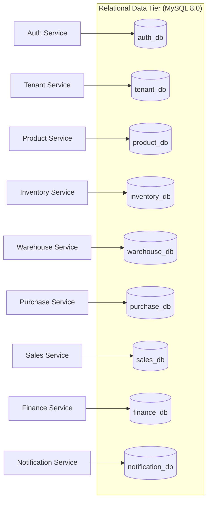

# StockPilot — Database Schema & Data Models

## 1. Database-per-Service Architecture

To prevent tight coupling between microservices, StockPilot employs the **Database-per-Service** pattern. Each service communicates only with its designated MySQL database.



---

## 2. Multi-Tenant Indexing Standard

Every business table includes a `tenant_id` column indexed for rapid retrieval and absolute boundary protection:
```sql
CREATE INDEX idx_tenant ON products(tenant_id);
CREATE INDEX idx_tenant_created ON sales_invoices(tenant_id, created_at DESC);
```

---

## 3. Schemas by Service Domain

### 🔐 1. `auth_db` (Auth Service)
- **`users`**:
  - `id`: INT (PK, Auto-increment)
  - `tenant_id`: INT (Nullable for Super Admin, otherwise Tenant ID)
  - `email`: VARCHAR(255) (Unique)
  - `password_hash`: VARCHAR(255)
  - `role_id`: INT
  - `status`: ENUM (`ACTIVE`, `SUSPENDED`, `INACTIVE`)
  - `refresh_token`: TEXT

### 🏢 2. `tenant_db` (Tenant & RBAC Service)
- **`tenants`**:
  - `id`: INT (PK)
  - `company_code`: VARCHAR(50) (Unique, e.g. `ABC001`)
  - `company_name`: VARCHAR(255)
  - `status`: ENUM (`ACTIVE`, `SUSPENDED`, `TRIAL`)
  - `plan`: ENUM (`FREE`, `STANDARD`, `ENTERPRISE`)
- **`roles`**:
  - `id`: INT (PK)
  - `tenant_id`: INT
  - `name`: VARCHAR(50) (`ADMIN`, `MANAGER`, `STAFF`, `ACCOUNTANT`)
- **`permissions`**:
  - `id`: INT (PK)
  - `key`: VARCHAR(100) (e.g. `inventory.manage`, `sales.create`)
- **`audit_logs`**:
  - `id`: INT (PK)
  - `tenant_id`: INT
  - `user_id`: INT
  - `action`: VARCHAR(100)
  - `ip_address`: VARCHAR(45)

### 📦 3. `product_db` (Product Catalog)
- **`products`**:
  - `id`: INT (PK)
  - `tenant_id`: INT (Index)
  - `name`: VARCHAR(255)
  - `sku`: VARCHAR(100)
  - `barcode`: VARCHAR(100)
  - `category_id`: INT
  - `brand_id`: INT
  - `cost_price`: DECIMAL(12,2)
  - `selling_price`: DECIMAL(12,2)
  - `tax_rate`: DECIMAL(5,2) (GST % default)
  - `reorder_level`: INT (Default: 10)
- **`categories`**: `id`, `tenant_id`, `name`, `slug`
- **`brands`**: `id`, `tenant_id`, `name`, `logo_url`

### 📊 4. `inventory_db` (Stock Engine)
- **`inventory`**:
  - `id`: INT (PK)
  - `tenant_id`: INT
  - `product_id`: INT
  - `warehouse_id`: INT
  - `current_stock`: INT (Physical quantity present)
  - `reserved_stock`: INT (Quantity locked in unpaid/pending orders)
  - *Formula: Available Stock = `current_stock` - `reserved_stock`*
- **`inventory_movements`**:
  - `id`: INT (PK)
  - `tenant_id`: INT
  - `product_id`: INT
  - `warehouse_id`: INT
  - `quantity`: INT (Delta change: positive or negative)
  - `movement_type`: ENUM (
    `PURCHASE`, `SALE`, `TRANSFER_IN`, `TRANSFER_OUT`,
    `ADJUSTMENT_IN`, `ADJUSTMENT_OUT`, `RETURN_IN`, `RETURN_OUT`
  )
  - `reference_id`: VARCHAR(100) (Invoice number, PO number, or Transfer ID)

### 🏭 5. `warehouse_db` (Warehouse Management)
- **`warehouses`**:
  - `id`: INT (PK)
  - `tenant_id`: INT
  - `name`: VARCHAR(255)
  - `location`: VARCHAR(255)
  - `is_primary`: BOOLEAN
- **`transfers`**:
  - `id`: INT (PK)
  - `tenant_id`: INT
  - `source_warehouse_id`: INT
  - `destination_warehouse_id`: INT
  - `status`: ENUM (`PENDING`, `APPROVED`, `DISPATCHED`, `COMPLETED`, `REJECTED`)
- **`transfer_items`**: `id`, `transfer_id`, `product_id`, `quantity`

### 🛒 6. `purchase_db` (Procurement)
- **`suppliers`**: `id`, `tenant_id`, `name`, `email`, `phone`, `gstin`, `address`
- **`purchase_orders`**:
  - `id`: INT (PK)
  - `tenant_id`: INT
  - `po_number`: VARCHAR(100) (Unique per tenant)
  - `supplier_id`: INT
  - `total_amount`: DECIMAL(12,2)
  - `status`: ENUM (`DRAFT`, `ORDERED`, `RECEIVED`, `CANCELLED`)
- **`purchase_order_items`**: `id`, `purchase_order_id`, `product_id`, `quantity`, `unit_cost`, `total`

### 💰 7. `sales_db` (Invoicing & POS)
- **`customers`**: `id`, `tenant_id`, `name`, `phone`, `email`, `outstanding_balance`
- **`sales_invoices`**:
  - `id`: INT (PK)
  - `tenant_id`: INT
  - `invoice_number`: VARCHAR(100)
  - `customer_id`: INT
  - `subtotal`: DECIMAL(12,2)
  - `tax_total`: DECIMAL(12,2)
  - `discount_total`: DECIMAL(12,2)
  - `grand_total`: DECIMAL(12,2)
  - `payment_status`: ENUM (`PAID`, `PARTIAL`, `UNPAID`)
  - `payment_method`: ENUM (`CASH`, `UPI`, `CARD`, `CREDIT`)
- **`sales_invoice_items`**: `id`, `invoice_id`, `product_id`, `warehouse_id`, `quantity`, `unit_price`, `total`

### 💳 8. `finance_db` (Ledger & Expenses)
- **`payments`**: `id`, `tenant_id`, `reference_type` (`SALE`/`PURCHASE`), `reference_id`, `amount`, `payment_method`
- **`expenses`**: `id`, `tenant_id`, `category_id`, `title`, `amount`, `expense_date`, `receipt_url`
- **`expense_categories`**: `id`, `tenant_id`, `name` (`Rent`, `Salary`, `Utilities`, `Logistics`)

### 🔔 9. `notification_db` (Notifications)
- **`notifications`**:
  - `id`: INT (PK)
  - `tenant_id`: INT
  - `title`: VARCHAR(255)
  - `message`: TEXT
  - `type`: ENUM (`LOW_STOCK`, `OUT_OF_STOCK`, `SALE`, `TRANSFER`, `SYSTEM`)
  - `is_read`: BOOLEAN (Default: false)

---

## 4. Initialization & Database Seeding

To create and populate all databases with realistic test fixtures:
```bash
node scripts/seed-all.js
```
This script sequentially creates the databases if not present, synchronizes Sequelize models, and generates default sample accounts (`superadmin@stockpilot.io`, `admin@abc.com`, etc.).
