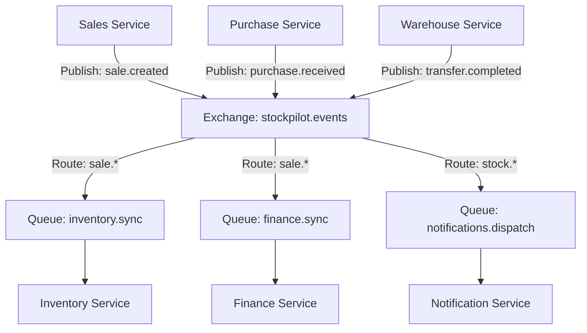
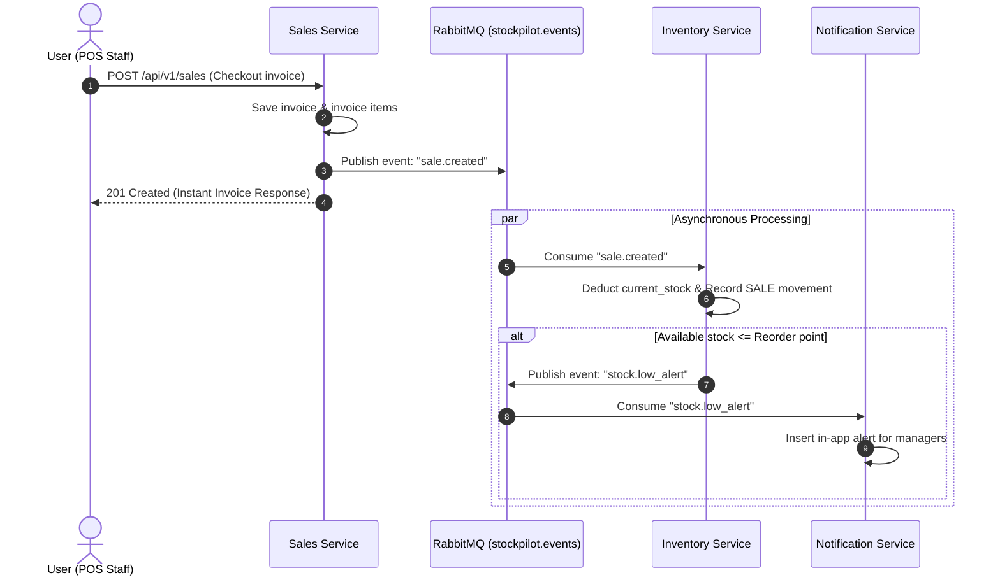
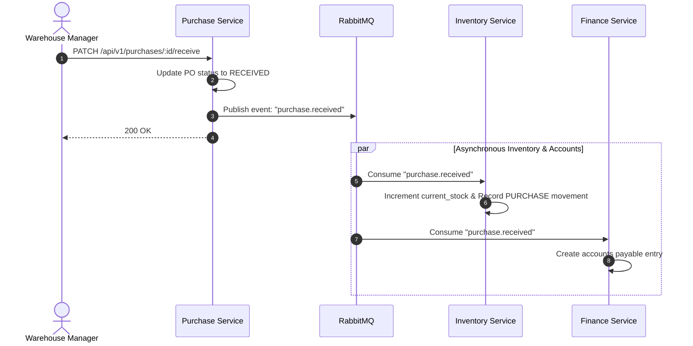

# StockPilot — Event-Driven Architecture & RabbitMQ Flows

## 1. Asynchronous Event-Driven Architecture

StockPilot utilizes **RabbitMQ** (topic exchange `stockpilot.events`) for asynchronous decoupled operations. This ensures that slow downstream tasks (such as sending alerts, audit logging, and financial ledger calculations) do not block immediate user checkout or inventory operations.



---

## 2. Key Business Event Workflows

### 🛒 Flow 1: Sales Checkout & Inventory Auto-Deduction



---

### 📦 Flow 2: Purchase Order Receipt & Automated Stock Intake



---

## 3. RabbitMQ Event Catalog

| Event Routing Key | Publisher | Subscribers | Action Triggered |
| :--- | :--- | :--- | :--- |
| `sale.created` | Sales Service | Inventory Service, Finance Service | Deducts physical inventory, logs revenue ledger entry. |
| `sale.cancelled` | Sales Service | Inventory Service | Releases reserved stock or restocks inventory. |
| `purchase.received` | Purchase Service | Inventory Service, Finance Service | Increments physical stock, logs vendor payable. |
| `stock.low_alert` | Inventory Service | Notification Service | Sends banner alert to Managers & Admins. |
| `transfer.dispatched`| Warehouse Service | Inventory Service | Moves stock from Source Warehouse to In-Transit. |
| `transfer.completed` | Warehouse Service | Inventory Service, Notification Service | Deposits stock into Destination Warehouse. |

---

## 4. Standard Event Payload Schema

All published events conform to this JSON schema:

```json
{
  "event": "sale.created",
  "eventId": "evt_9a8b7c6d5e4f",
  "tenantId": 1,
  "timestamp": "2026-10-13T10:15:00.000Z",
  "data": {
    "invoiceId": 1052,
    "invoiceNumber": "INV-2026-0012",
    "warehouseId": 3,
    "items": [
      {
        "productId": 204,
        "quantity": 5,
        "unitPrice": 1200.00
      }
    ]
  }
}
```

---

## 5. Resilience & Connection Management

The shared event bus client (`services/common/src/events/eventBus.js`) includes:
- **Automatic Reconnection**: Re-attempts connection upon broker disconnection.
- **Graceful Fallback**: If `RABBITMQ_URL` is omitted in development, operations log a warning and fallback gracefully without crashing HTTP endpoints.
- **Durable Exchanges**: `stockpilot.events` is asserted with `{ durable: true }` to survive broker restarts.
