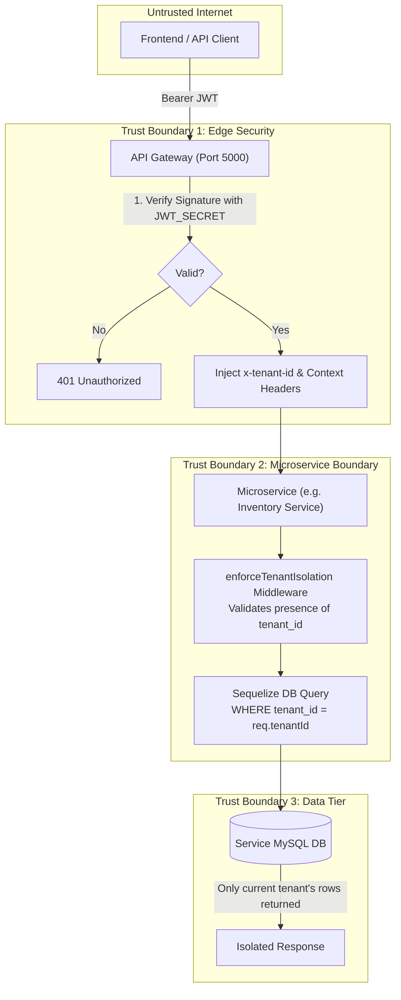

# StockPilot — Security & Multi-Tenancy Architecture

## 1. Multi-Tenancy Isolation Model

StockPilot enforces **Strict Logical Row-Level Multi-Tenancy**. Multiple organizations share the infrastructure, but their business data is completely isolated using tenant context checks at both the API Gateway and database querying layers.



---

## 2. Authentication & JWT Context Lifecycle

### Step 1: Login Request
Users authenticate directly using their credentials without entering a manual company code:
- `email` (e.g. `admin@abc.com` or `superadmin@stockpilot.io`)
- `password`

Tenant organization context and RBAC permissions are automatically resolved on the backend through secure tenant lookup mapping.

### Step 2: Token Issuance
Auth Service verifies credentials (comparing Bcrypt hash) and returns signed JSON Web Tokens containing:
```json
{
  "userId": 104,
  "tenantId": 12,
  "companyCode": "ABC001",
  "companyName": "ABC Electronics",
  "roleName": "ADMIN",
  "isSuperAdmin": false,
  "permissions": ["inventory.view", "inventory.manage", "sales.create"],
  "iat": 1728800000,
  "exp": 1728886400
}
```

### Step 3: Gateway Context Injection
The API Gateway decodes verified tokens and maps them into trusted HTTP headers forwarded downstream:
- `x-tenant-id`: Target company tenant identifier (`12`)
- `x-user-id`: Authenticated user ID (`104`)
- `x-user-role`: User role (`ADMIN`)
- `x-company-code`: Organization slug (`ABC001`)
- `x-user-permissions`: Serialized JSON array of permissions
- `x-is-super-admin`: `'true'` or `'false'`

> [!IMPORTANT]
> Downstream microservices NEVER trust `req.body.tenant_id` or query parameters sent by the client. The tenant scope is strictly extracted from `req.headers['x-tenant-id']` injected by the gateway.

---

## 3. Defense-in-Depth Middleware Pattern

Every service relies on `services/common/src/middleware/tenantIsolation.js`:

```javascript
// Example: Scoped Query helper
const { withTenant } = require('../middleware/tenantIsolation');

// Query is guaranteed to be isolated to the caller's organization
const items = await Product.findAll({
  where: withTenant(req.tenantId, { status: 'ACTIVE' })
});
```

### Super Admin Privileges
- Super Admins (`isSuperAdmin: true`) can inspect any tenant by supplying an explicit `tenantId` query parameter or header for auditing and support.
- Standard tenant accounts are locked to their own `tenant_id` and receive `403 Forbidden` if attempting cross-tenant access.

---

## 4. Role-Based Access Control (RBAC) Matrix

| Permission Domain | `SUPER_ADMIN` | `ADMIN` | `MANAGER` | `STAFF` | `ACCOUNTANT` |
| :--- | :---: | :---: | :---: | :---: | :---: |
| **Manage Organizations / Tenants** |  Full | ❌ | ❌ | ❌ | ❌ |
| **System-wide Audit Logs** |  Full | ❌ | ❌ | ❌ | ❌ |
| **Manage Company Users & Roles** |  Full |  Full | ❌ | ❌ | ❌ |
| **Product Catalog (Create/Edit)** |  Full |  Full |  Full | 👁️ View | 👁️ View |
| **Inventory & Stock Adjustments** |  Full |  Full |  Full | ❌ | 👁️ View |
| **Warehouse Transfers** |  Full |  Full |  Full | ❌ | ❌ |
| **Transfer Inward Receipt (GRN)** |  Full | ⚠️ HQ Override |  Destination Only | ❌ (Sign-Off Locked) | ❌ |
| **Purchase Orders & Intake** |  Full |  Full |  Full | ❌ | 👁️ View |
| **Sales & POS Invoicing** |  Full |  Full |  Full |  Full | 👁️ View |
| **Financial Ledger & Expenses** |  Full |  Full | 👁️ View | ❌ |  Full |

### 🔒 Inter-Hub Transfers: Segregation of Duties
- **Global HQ Jurisdiction for Tenant Admin**: The Tenant Administrator (`role: ADMIN`) represents the business owner and retains company-wide Global HQ jurisdiction (`warehouseId: null` in JWT token payloads) across all facilities, storefront builder, finance, user management, and settings. Branch scoping strictly binds only operational facility personnel (`role: MANAGER` and `role: STAFF`) to specific warehouse IDs.
- **Origin Dispatch Protection**: Personnel or managers assigned to the origin warehouse who dispatched a transfer are prohibited from confirming destination goods receipt (`Receive Goods into Stock`).
- **Destination Verification**: Only users assigned to the destination facility (`warehouse_id === transfer.to_warehouse_id`) can physically accept items into local stock.
- **Staff vs Manager Boundary**: Store Associates & Cashiers (`STAFF`) are limited to POS billing, invoicing, and read-only transfer tracking. They cannot initiate, dispatch, or confirm inward stock intake into the inventory valuation ledger. Inward intake requires `MANAGER` or `ADMIN` authority.
- **HQ Central Override**: Global Admins (`warehouse_id: null`) can perform an explicit audited clearance (`HQ Inward Clearance`) on behalf of a destination hub when authorized, with an explicit confirmation modal preventing accidental cross-hub receipt.

---

## 5. API Hardening & Abuse Prevention

### 1. Multi-Tier Rate Limiting
- **Strict Auth & OTP Limiter**: Applies to `/api/v1/auth/login` and `/api/v1/sales/public/otp` (Max 30 requests per 15 minutes per IP). Blocks credential brute-forcing and prevents Brevo email relay credit exhaustion.
- **Tenant-Aware Limiter**: Evaluated per organization keyed on verified `x-tenant-id` (Max 600 requests per minute). Prevents noisy-neighbor starvation where one tenant's load impacts other organizations.
- **Global IP Limiter**: Gateway fallback (Max 1,000 requests per 15-minute window per IP) returning `429 Too Many Requests`.

### 2. Configurable Dynamic CORS
- API Gateway parses `CORS_ORIGIN` environment variable (comma-separated origins).
- Supports credentials while restricting cross-origin resource sharing to trusted tenant and storefront frontend domains in production.

### 3. Distributed Tracing (`x-request-id`)
- API Gateway automatically generates a cryptographically unique `x-request-id` (`sp-<timestamp>-<hex>`) if not provided by client.
- Propagates throughout all downstream microservices and response headers for seamless end-to-end audit logging.

### 4. Idempotency Support
- POS checkout and financial transactions accept `Idempotency-Key` or `x-idempotency-key`.
- Prevents double-billing or duplicate stock deduction if network retries occur.

### 5. HTTP Security Headers
- Helmet enabled on Gateway to apply HSTS, X-Content-Type-Options, Frameguard, and X-XSS-Protection.

### 6. Parameterized SQL Queries
- All databases use Sequelize ORM with prepared statements, preventing SQL injection vulnerabilities.

---

## 6. Production Security Checklist

- [x] Run `npm run validate:env` (or `node scripts/validate-env.js`) to verify all production keys and secrets.
- [ ] Change default `JWT_SECRET` and `JWT_REFRESH_SECRET` from `.env.example` defaults.
- [ ] Ensure database root password is unique and not committed to git repository.
- [ ] Enforce HTTPS termination via Nginx (`deploy/nginx/stockpilot.conf`) or Cloudflare reverse proxy in front of port 5000.
- [ ] Rotate demo passwords (`password123`) before connecting to public networks.
