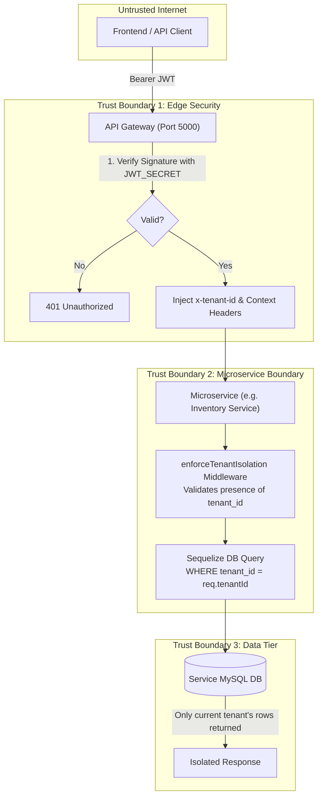

# StockPilot — Security & Multi-Tenancy Architecture

## 1. Multi-Tenancy Isolation Model

StockPilot enforces **Strict Logical Row-Level Multi-Tenancy**. Multiple organizations share the infrastructure, but their business data is completely isolated using tenant context checks at both the API Gateway and database querying layers.



---

## 2. Authentication & JWT Context Lifecycle

### Step 1: Login Request
Users authenticate using three attributes:
- `company_code` (e.g. `ABC001`)
- `email` (e.g. `admin@abc.com`)
- `password`

### Step 2: Token Issuance
Auth Service verifies credentials (comparing Bcrypt hash) and returns signed JSON Web Tokens containing:
```json
{
  "userId": 104,
  "tenantId": 12,
  "companyCode": "ABC001",
  "companyName": "ABC Electronics",
  "roleName": "ADMIN",
  "isSuperAdmin": false,
  "permissions": ["inventory.view", "inventory.manage", "sales.create"],
  "iat": 1728800000,
  "exp": 1728886400
}
```

### Step 3: Gateway Context Injection
The API Gateway decodes verified tokens and maps them into trusted HTTP headers forwarded downstream:
- `x-tenant-id`: Target company tenant identifier (`12`)
- `x-user-id`: Authenticated user ID (`104`)
- `x-user-role`: User role (`ADMIN`)
- `x-company-code`: Organization slug (`ABC001`)
- `x-user-permissions`: Serialized JSON array of permissions
- `x-is-super-admin`: `'true'` or `'false'`

> [!IMPORTANT]
> Downstream microservices NEVER trust `req.body.tenant_id` or query parameters sent by the client. The tenant scope is strictly extracted from `req.headers['x-tenant-id']` injected by the gateway.

---

## 3. Defense-in-Depth Middleware Pattern

Every service relies on `services/common/src/middleware/tenantIsolation.js`:

```javascript
// Example: Scoped Query helper
const { withTenant } = require('../middleware/tenantIsolation');

// Query is guaranteed to be isolated to the caller's organization
const items = await Product.findAll({
  where: withTenant(req.tenantId, { status: 'ACTIVE' })
});
```

### Super Admin Privileges
- Super Admins (`isSuperAdmin: true`) can inspect any tenant by supplying an explicit `tenantId` query parameter or header for auditing and support.
- Standard tenant accounts are locked to their own `tenant_id` and receive `403 Forbidden` if attempting cross-tenant access.

---

## 4. Role-Based Access Control (RBAC) Matrix

| Permission Domain | `SUPER_ADMIN` | `ADMIN` | `MANAGER` | `STAFF` | `ACCOUNTANT` |
| :--- | :---: | :---: | :---: | :---: | :---: |
| **Manage Organizations / Tenants** |  Full | ❌ | ❌ | ❌ | ❌ |
| **System-wide Audit Logs** |  Full | ❌ | ❌ | ❌ | ❌ |
| **Manage Company Users & Roles** |  Full |  Full | ❌ | ❌ | ❌ |
| **Product Catalog (Create/Edit)** |  Full |  Full |  Full | 👁️ View | 👁️ View |
| **Inventory & Stock Adjustments** |  Full |  Full |  Full | ❌ | 👁️ View |
| **Warehouse Transfers** |  Full |  Full |  Full | ❌ | ❌ |
| **Purchase Orders & Intake** |  Full |  Full |  Full | ❌ | 👁️ View |
| **Sales & POS Invoicing** |  Full |  Full |  Full |  Full | 👁️ View |
| **Financial Ledger & Expenses** |  Full |  Full | 👁️ View | ❌ |  Full |

---

## 5. API Hardening & Abuse Prevention

### 1. Rate Limiting
- Configured at API Gateway via `express-rate-limit`.
- Max **1,000 requests per 15-minute window** per client IP.
- Returns `429 Too Many Requests` with code `RATE_LIMIT_EXCEEDED` on breach.

### 2. Idempotency Support
- POS checkout and financial transactions accept `Idempotency-Key` or `x-idempotency-key`.
- Prevents double-billing or duplicate stock deduction if network retries occur.

### 3. HTTP Security Headers
- Helmet enabled on Gateway to apply HSTS, X-Content-Type-Options, Frameguard, and X-XSS-Protection.

### 4. Parameterized SQL Queries
- All databases use Sequelize ORM with prepared statements, preventing SQL injection vulnerabilities.

---

## 6. Production Security Checklist

- [ ] Change default `JWT_SECRET` and `JWT_REFRESH_SECRET` from `.env.example` defaults.
- [ ] Ensure database root password is unique and not committed to git repository.
- [ ] Enforce HTTPS termination via Nginx / Cloudflare reverse proxy in front of port 5000.
- [ ] Rotate demo passwords (`password123`) before connecting to public networks.
